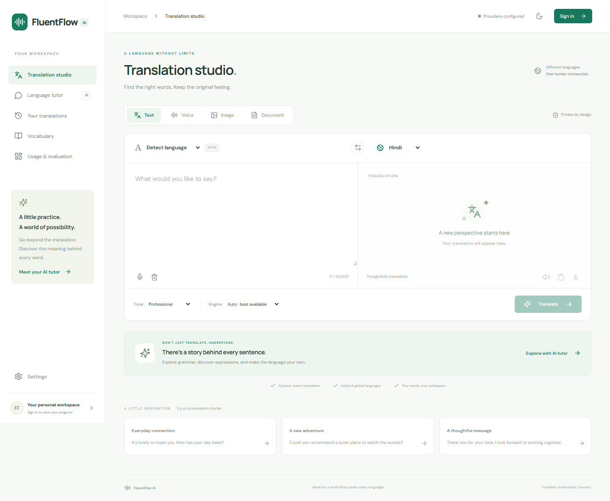
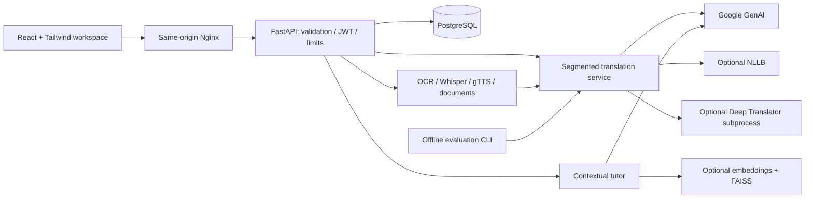

# FluentFlow AI — Multimodal Translation & Intelligent Language Learning Platform

A React/Tailwind translation workspace backed by a modular FastAPI service. Translate
text, images, audio and documents; study translations with a contextual AI tutor;
keep private history, vocabulary and learning sessions. The original Flask UI is
preserved as a local compatibility interface.

**Release status:** implemented locally with deterministic tests, Linux container
smoke checks and PostgreSQL integration. Real model quality and cloud deployment
remain release gates. The API image was verified using pinned local wheels after
Docker's package-host TLS downloads failed; the normal network build needs CI confirmation.
No BLEU, chrF, COMET, WER, CER or production performance improvement is claimed.



Screenshots show the UI with intercepted API capability responses in browser tests;
they are not evidence of a live provider deployment.

## Capabilities

| Capability | Implementation and requirements |
| --- | --- |
| Text translation | Auto source detection, six tones, paragraph-aware segmentation up to 50,000 characters, model selection, retries and explicit failover metadata |
| Gemini | Maintained `google-genai` SDK; validated Pydantic JSON output; configurable model and native request timeout |
| Optional local baseline | Lazy NLLB-200 distilled 600M with source detection and token-limit checks; CPU inference; review noncommercial model license |
| Optional fallback | Deep Translator, explicitly enabled; isolated in a subprocess that is terminated on timeout; no tone control |
| Language tutor | Grammar, vocabulary, idioms, pronunciation, alternatives, exercises and next steps; private server-side conversation memory |
| Optional RAG | Multilingual Sentence Transformer embeddings + FAISS, similarity threshold, approved source-ID filtering; three English grammar reference summaries included |
| Voice | Browser dictation, microphone recording/audio upload, optional faster-whisper recognition and detected language, translation, authenticated gTTS playback |
| Images | Decode/pixel validation, EXIF orientation, OpenCV grayscale/Otsu preprocessing, Tesseract reading order, selectable installed OCR language packs |
| Documents | TXT/PDF/DOCX extraction, background job status, segmentation, private TXT/DOCX export; no public upload directory |
| Personal workspace | JWT/Argon2 accounts, history, vocabulary, learning sessions, preferences, account/data deletion, retention cleanup |
| Evaluation | BLEU/chrF, optional COMET, WER/CER, latency percentiles, observed throughput, failures/fallbacks, configurable token-cost estimates, JSON/Markdown/chart artifacts |

The configured UI language set includes English, Hindi, Kannada, Tamil, Telugu,
Malayalam, Marathi, Bengali, Gujarati, Punjabi, Urdu, Nepali, Spanish, French,
German, Italian, Portuguese, Arabic, Japanese, Korean, Chinese and Russian.
Provider/recognition/OCR/TTS language support differs. Unsupported speech synthesis
returns a clear error rather than substituting another language.

## Architecture and decisions



PostgreSQL is the production store: relational account ownership, unique email,
foreign keys, transaction support, and a composite user/kind/time index. SQLAlchemy
JSON records hold bounded translation and learning metadata. SQLite is a persistent
development/test convenience, not a silent production fallback. No in-memory user
database is used. Records expire after `RETENTION_DAYS` (30 by default); startup
and hourly cleanup remove expired records. Account deletion removes all records.
Backups have their own retention policy and must be managed by the operator.

Providers share an adapter interface, independent of the frontend. Gemini supports
tone/context; NLLB provides a downloadable baseline; Deep Translator is opt-in
because source text is sent to an unofficial external translation service. Gemini
and gTTS also transmit submitted text to their respective services. Model IDs and
prices are configuration, not hardcoded availability or cost claims. The default
Gemini model follows the [official model catalog](https://ai.google.dev/gemini-api/docs/models).
Review the [NLLB model card and license](https://huggingface.co/facebook/nllb-200-distilled-600M)
before enabling it, especially for commercial use.

## Project layout

```text
backend/app/
  main.py             application lifecycle, limits, errors, health
  config.py           environment validation
  database.py         SQLAlchemy ownership and persistence
  security.py         JWT and Argon2
  schemas.py          bounded API and structured model output schemas
  routes/api.py       auth, translation, learning, media and usage routes
  ai/                 provider adapters and prompt templates
  services/           translation segmentation, RAG and media processing
backend/knowledge/    curated, attributed grammar reference summaries
frontend/src/         React workspace, API client, themes and component tests
frontend/e2e/         desktop/mobile Playwright tests
evaluation/           scoring, real-provider benchmarking, FLORES preparation
tests/                deterministic API/service/security/evaluation tests
deployment/           Nginx and production runbook
docs/                 audit, release status and screenshots
app.py                original Flask route compatibility interface
templates/, static/   preserved Flask UI with escaped model rendering
```

The supplied local checkout contained only `AI-Translator-Pro/README.md` in that
directory. The GitHub repository also contains an earlier implementation there;
those upstream files are preserved for reference. The maintained FluentFlow AI
application lives in the root `backend/` and `frontend/` folders described above.
See [the baseline audit and roadmap](docs/ROADMAP.md).

## Local setup

Use Python 3.11+ and Node.js 22. From this repository:

```powershell
python -m venv .venv
.venv\Scripts\Activate.ps1
python -m pip install -r requirements-api.lock -r requirements-dev.txt
Copy-Item .env.example .env  # only if .env does not already exist
```

Set `GEMINI_API_KEY` and a random `JWT_SECRET` in `.env`. Preserve existing secrets.
Generate a secret with `python -c "import secrets; print(secrets.token_urlsafe(48))"`.
Start the API:

```sh
uvicorn backend.app.main:app --reload --port 8000 --no-access-log
```

In another terminal:

```sh
cd frontend
npm ci
npm run dev
```

Open **http://localhost:5173** and create an account. The Vite server proxies API
requests to port 8000. OpenAPI: **http://localhost:8000/docs**. Without a configured
provider, the interface still opens; translation returns an honest 503 and
readiness remains false. Credentials are never embedded in the browser bundle.

The Flask compatibility UI can run separately after installing `requirements.txt`:
`python app.py`, then http://127.0.0.1:5000. It has no account isolation and is
intended for local use only. Debug mode is disabled and generated audio is returned
in memory. For its former free fallback, explicitly set `ENABLE_DEEP_TRANSLATOR=true`.

## Configuration

| Variable | Default / meaning |
| --- | --- |
| `ENVIRONMENT` | `development`; production enforces PostgreSQL and an explicit strong secret |
| `DATABASE_URL` | `sqlite:///./fluentflow.db`; production `postgresql+psycopg://...` |
| `JWT_SECRET` | Random ephemeral development secret if absent; set stable secret for restart-safe sessions |
| `TOKEN_MINUTES` | 60; access JWT lifetime |
| `GEMINI_API_KEY`, `GEMINI_MODEL` | Server only; default model `gemini-3.5-flash-lite` |
| `PROVIDER_ORDER` | `gemini`; comma-separated IDs, e.g. `gemini,nllb,deep-translator` |
| `ENABLE_DEEP_TRANSLATOR` | false; explicit external fallback opt-in |
| `ENABLE_NLLB`, `ENABLE_SPEECH`, `ENABLE_RAG` | false; require optional ML packages and model downloads |
| `WHISPER_MODEL` | `base`; lazy CPU/int8 faster-whisper model |
| `PROVIDER_TIMEOUT`, `PROVIDER_RETRIES` | 30 seconds per attempt, 1 retry |
| `RATE_LIMIT` | 30 API requests/minute/account per process; anonymous requests use IP; configure ingress limits too |
| `MAX_UPLOAD_MB` | 10; request body and decoded content are additionally validated |
| `RETENTION_DAYS` | 30; automatic record retention |
| `CORS_ORIGINS` | `http://localhost:5173`; explicit comma-separated origins |
| `GEMINI_INPUT_USD_PER_MILLION`, `GEMINI_OUTPUT_USD_PER_MILLION` | Unset; cost remains null until current rates are supplied |

Optional model packages: `pip install -r requirements-ml.txt`. Expect substantial
downloads and CPU/RAM usage. For Docker, set `INSTALL_ML=true` before building.
Install Tesseract separately for local OCR and add it to PATH. The container includes
English, Hindi, Kannada, Tamil, Telugu, French, Spanish and German packs; install
additional requested packs explicitly. No speech/RAG/NLLB models download at startup.

## API examples and contracts

All personal/media routes require `Authorization: Bearer <token>`.
Signup/login accepts JSON `{email,password,name?}`; passwords have 10–128 characters.

```json
POST /api/v1/translate
{
  "text": "It is lovely to meet you.",
  "src_lang": "auto",
  "target_lang": "hi",
  "tone": "conversational",
  "provider": "auto",
  "allow_fallback": true
}
```

The response includes `translated_text`, `detected_language`, `providers`, `fallback`,
`provider_failures`, `latency_ms`, token usage, optional cost, warnings and a private
history ID. Explicit provider selection can still fail over unless
`allow_fallback=false`; offline baseline benchmarks always disable fallback.

| Endpoint | Behavior |
| --- | --- |
| `GET /health/live`, `/health/ready` | Liveness; database plus provider configuration readiness (no live model probe) |
| `GET /api/v1/capabilities` | Configured adapters, language catalog, speech/RAG flags |
| `POST /api/v1/auth/signup`, `/auth/login` | Account creation and bearer JWT |
| `GET/DELETE /api/v1/me` | Profile / irreversible account-and-data deletion |
| `PATCH /api/v1/me/preferences` | Theme and target language |
| `GET /api/v1/history?offset=0&limit=30` | Private paginated translations |
| `DELETE /api/v1/history/{id}` | Delete owned translation |
| `GET/POST /api/v1/vocabulary`, `DELETE /vocabulary/{id}` | Private saved words |
| `POST /api/v1/tutor` | `{question,session_id,translation_id?,use_rag?}`; validated tutor output and references |
| `GET /api/v1/tutor/{session_id}` | Private saved learning turns |
| `GET /api/v1/tutor-sessions` | Recent private sessions, available to restore in the tutor UI |
| `POST /api/v1/image/translate` | Multipart `file,target_lang,ocr_language` |
| `POST /api/v1/speech/translate` | Multipart `file,target_lang`; transcript + translation |
| `POST /api/v1/speech/synthesize` | `{text,lang}` → private MP3 bytes |
| `POST /api/v1/documents` | Multipart `file,target_lang` → 202 job ID |
| `GET /api/v1/documents/{id}` | Job status or safe failure |
| `GET /api/v1/documents/{id}/download?format=txt` | Owned TXT or DOCX download |
| `GET /api/v1/metrics` | Private measured usage, null quality scores |
| `POST /api/v1/me/purge-expired` | Apply retention immediately to owned records |

## Tests and evaluation

```sh
pytest -q
ruff check backend tests evaluation app.py
cd frontend
npm test
npm run build
npx playwright install chromium
npm run test:e2e
```

Normal tests inject deterministic providers and mock successful OCR/speech calls;
they make no paid API calls or model downloads. Invalid image decoding and document
extraction/export are tested with real libraries. E2E tests intercept API responses
to verify UI behavior; they do not prove live provider accuracy. Python tests also
exercise authentication, ownership, persistence, failed providers and timeout behavior.
See [verification status](docs/VERIFICATION.md) for exact executed results and limits.

Use licensed FLORES-200 data to compare real models:

```sh
python -m evaluation.prepare_flores source.txt reference.txt --src-lang en --target-lang hi --out evaluation/flores-en-hi.jsonl
python -m evaluation.run evaluation/flores-en-hi.jsonl --providers gemini nllb --out evaluation/results/en-hi
```

The second command makes real provider calls and may incur charges. Install optional
model packages first. See [evaluation methodology](evaluation/README.md) for BLEU
tokenization, COMET setup, WER/CER inputs, chart generation, manifests and limitations.
No public reference dataset has been downloaded or evaluated in this implementation.

## Containers and deployment

Set `POSTGRES_PASSWORD` to a random URL-safe value, `JWT_SECRET` to a random secret
and `GEMINI_API_KEY` in `.env` before running:

```sh
docker compose up --build -d
docker compose logs -f api
docker compose ps
```

Open http://localhost:8080. PostgreSQL is not published to the host and the API is
reachable through Nginx. Services run as nonroot users except the upstream PostgreSQL
entrypoint's initialization phase. Backend and frontend have health checks.
`docker compose down` preserves the database volume; `down -v` deletes it.

CI runs lint, deterministic tests, frontend build, browser tests, container builds
and an isolated PostgreSQL HTTP smoke test. A manually triggered publish workflow
builds immutable SHA-tagged images in GHCR. The default root Docker image also
serves React directly, providing a single-service deployment for the selected
Docker hosts. The active AWS deployment uses prepared ECS Express Mode/RDS
[CloudFormation templates](deployment/aws/README.md). The earlier
[VibeNest configuration](deployment/VIBENEST.md) remains available. Cloud deployment
has not been executed; AWS sign-in, region, budget and secret configuration are pending.

## Security and current limitations

- Passwords use Argon2; JWTs validate algorithm, issuer, audience, expiry and account
  existence. Tokens live in React memory, not localStorage. Reload requires login.
  There is no email verification, password reset, refresh-token flow or MFA yet.
- Inputs, uploaded bytes, image pixels, DOCX expansion, PDF page counts, and audio
  duration are bounded. React renders model output as text. The legacy Markdown
  formatter now escapes HTML. Errors omit provider internals and credentials.
- Prompts separate system rules from JSON user data and model outputs are validated.
  This reduces prompt-injection risk; it does not guarantee semantic correctness.
- Jobs run in-process with private persisted status/results. Restart marks pending
  jobs failed. Use **one API worker/instance**; introduce a durable external queue
  before replicas, retries across restart or high-volume document work. Local model
  inference cannot be forcefully interrupted safely in a thread; HTTP waiting is
  bounded and concurrent provider work is capped. Cold downloads may exceed timeout.
- PDF extraction supports text PDFs, not scanned-document OCR. Export preserves
  paragraphs/line breaks, not original PDF geometry, DOCX run formatting or exact
  table positions. Downloads are UTF-8 TXT and paragraph-based DOCX, not PDF.
- RAG has a small English grammar seed corpus with multilingual embeddings; it is
  not a comprehensive multilingual linguistic database. Semantic thresholds require
  evaluation. Citations are constrained to retrieved IDs; answers still need review.
- Streaming recognition and streaming LLM output are not implemented. Browser
  recording is capped at 60 seconds, uploaded audio at five minutes. Browser dictation
  availability and privacy depend on the browser vendor.
- Usage monitoring covers the latest 1,000 user text/image/speech translation requests;
  document/tutor usage is not aggregated. Cost estimates exclude network, hosting,
  retries with unknown usage, cache discounts and local compute; partial costs must
  not be interpreted as invoices.
- Schema creation is automatic for the initial schema. Add reviewed migration scripts
  before changing a production schema. Apply TLS, backups, secret rotation and
  real-client ingress rate limits before public exposure. Authenticated limits use
  verified JWT subjects; anonymous requests behind Nginx share its IP limit.
- The frontend image build, a local-wheel full-stack image build, PostgreSQL HTTP
  integration and native English OCR smoke check passed. Full multilingual OCR,
  native Whisper/RAG/NLLB, paid provider accuracy, model benchmarks, load testing,
  the normal network-based API build and cloud deployment remain release gates.

Future work: durable job queue, database migrations, expanded reviewed multilingual
knowledge, refresh/recovery authentication, streaming, document layout reconstruction,
distributed tracing and measured multilingual quality baselines.
